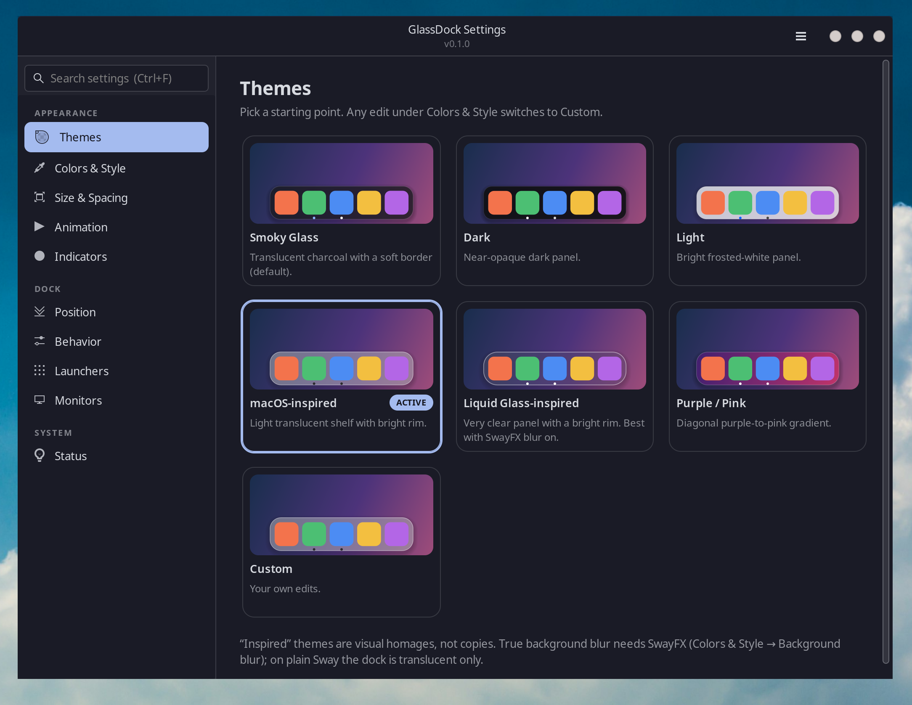
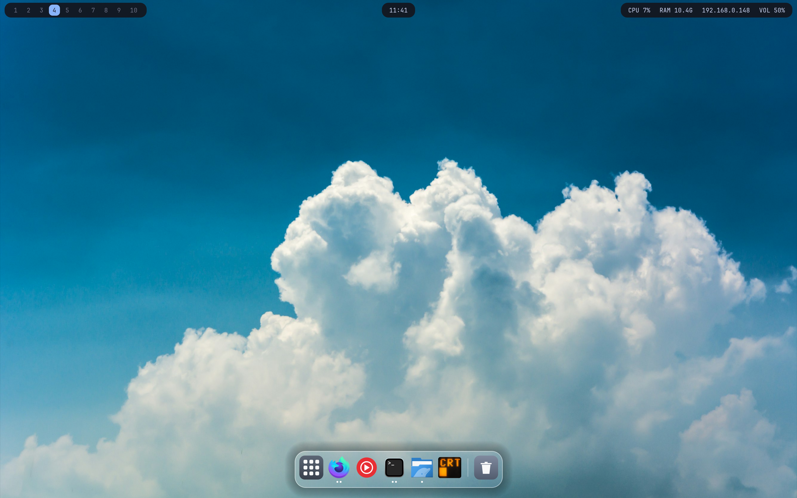
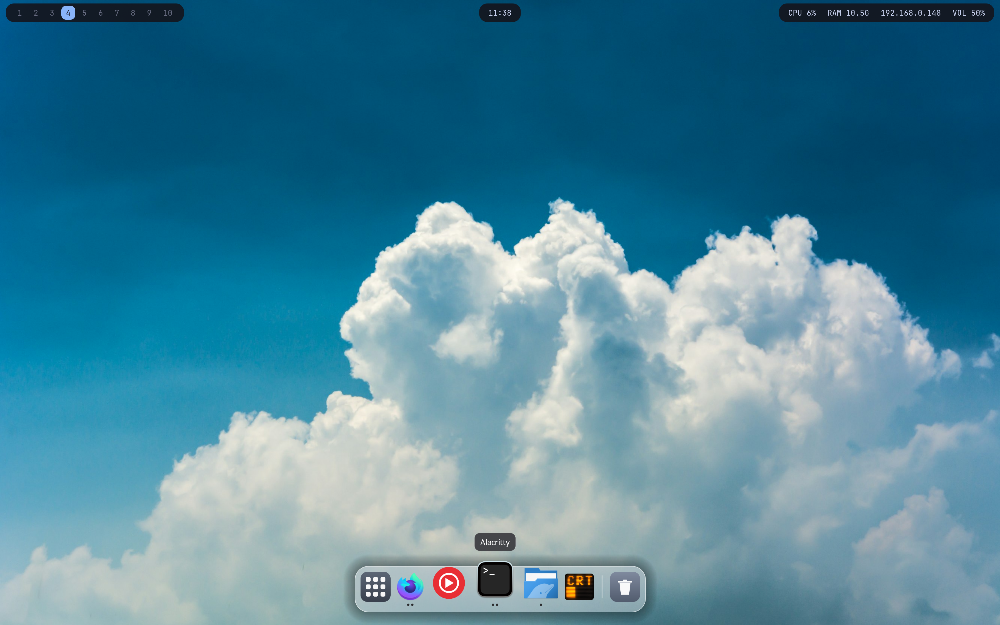
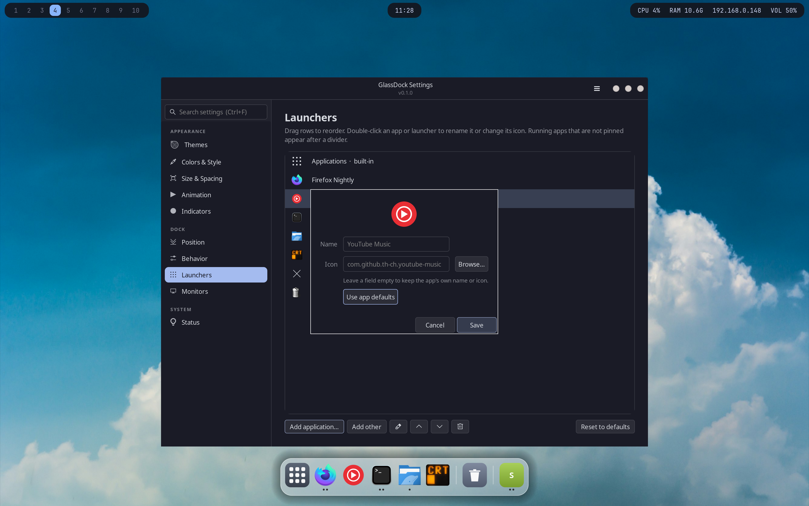

<h1 align="center">&nbsp;GlassDock</h1>

<p align="center">A dock for Wayland desktops.</p>

<p align="center"><code>curl -fsSL https://raw.githubusercontent.com/Mandrusian/GlassDock/master/installer.sh | bash</code></p>

<p align="center"><a href="https://raw.githubusercontent.com/Mandrusian/GlassDock/master/installer.sh">View installer source</a></p>

## Requirements

- A Wayland session with layer-shell support.
- Python 3.9+, GTK 3, PyGObject, Pycairo, and gtk-layer-shell.
- Sway or SwayFX is recommended. Background blur requires SwayFX.

## Start

After installation:

```bash
glassdock &
glassdock-settings
glassdock-ctl status
```

## Manual installation

```bash
git clone https://github.com/Mandrusian/GlassDock.git
cd GlassDock
./scripts/install-deps.sh
./install.sh
```

## Other links

- [Advanced README](README-advanced.md) — setup, controls, configuration, autostart, updates, uninstalling, and troubleshooting.
- [GlassIcon Studio](extras/GlassIcon/README.md) — companion icon tool.
- [License](LICENSE)
- [Third-party notices](THIRD_PARTY_NOTICES.md)

## Screenshots

<details>
<summary>View screenshots</summary>

<table>
<tr>
<td></td>
<td></td>
</tr>
<tr>
<td></td>
<td></td>
</tr>
<tr>
<td></td>
<td></td>
</tr>
</table>

</details>

